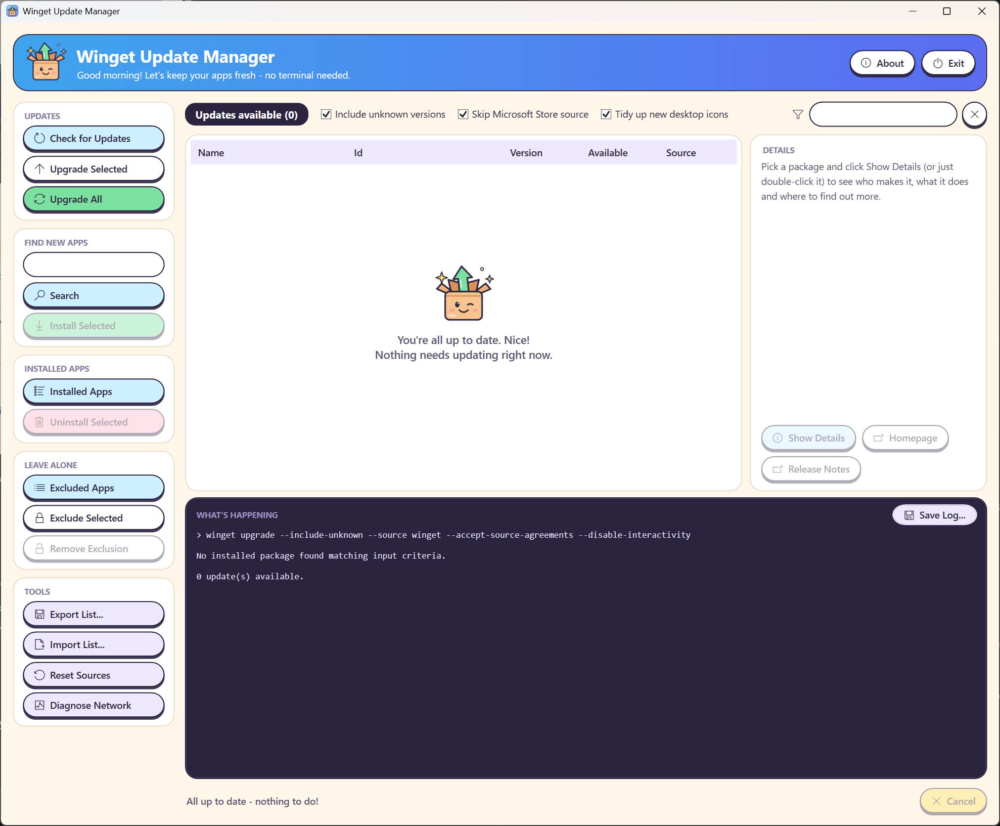

<p align="center">
  
</p>

# Winget Update Manager

A friendly window for winget: check for updates, upgrade, install and remove apps without the command line.


## ✨ Features

- **Check for updates** on launch, with outdated apps in a sortable list (Name, Id, Version, Available, Source).
- **Upgrade All**, or **Upgrade Selected** for one or several apps (Ctrl+click or Shift+click to pick more than one).
- **Search** winget's sources and **Install Selected** from the results.
- **Installed Apps** lists everything on the PC, including apps that didn't come from winget, with **Uninstall Selected**.
- **Exclude Selected** keeps chosen apps out of Upgrade All. Exclusions are winget pins, so they also apply to `winget upgrade --all` and to unattended mode.
- **Export List** and **Import List** copy a set of apps from one PC to another (`winget export` / `winget import`).
- **Details pane** with the publisher, licence, description, release notes and tags, plus Homepage and Release Notes buttons.
- **Live log** with a progress card, a Cancel button that also stops the installer winget started, and **Save Log**.
- **Tidy up new desktop icons** that installs and upgrades leave behind, only removing icons whose names match the apps involved.
- **Reset Sources** and **Diagnose Network** for the "Failed when searching source" errors, including proxy and SSL inspection checks.
- **Unattended mode** (`-UpgradeAll`) for Task Scheduler or Intune, with a log file and winget's exit code.
- Friendly pop-ups that say what each button does. For risky ones, Enter picks the safe answer.

## 🖼️ Screenshots



## 📋 Requirements

- Windows 10 or 11 with [App Installer](https://apps.microsoft.com/detail/9nblggh4nns1), which provides winget. winget 1.5 or later is needed for excluding apps (`winget pin`).
- Windows PowerShell 5.1 (built into Windows) or PowerShell 7, when running the script rather than the exe.
- Administrator rights. The app asks for them (UAC) when it starts.

## 📦 Installation

**Exe:** download `Winget Update Manager v1.00.exe` from the [Releases](../../releases) page and run it. Nothing else to install.

**Script:** clone the repo, or download it as a zip, and run:

```powershell
powershell -ExecutionPolicy Bypass -File .\src\Winget-Update-Manager.ps1
```

The script relaunches itself elevated, and in STA mode under PowerShell 7, so it can be started from any prompt or by double-clicking.

**Building the exe:** the exe is built with the shared build script, which reads `build.json` and the version from this CHANGELOG:

```powershell
E:\Created\_shared\Build-Tool.ps1 -Project "E:\Created\Home\Winget-Update-Manager"
```

It is compiled with ps2exe using `-STA -requireAdmin -noConsole` and `assets\icon.ico`, and saved to `Builds\` as `Winget Update Manager v<version>.exe`.

## 🚀 Usage

Open the app and it checks for updates straight away. Use the sidebar to switch between updates, search results, installed apps and excluded apps, then select apps in the list and use the matching **Selected** button. Type in the filter box to narrow the list; it only changes what's shown.

### Unattended mode (Task Scheduler or Intune)

```powershell
powershell -ExecutionPolicy Bypass -File .\src\Winget-Update-Manager.ps1 -UpgradeAll -Silent
"Winget Update Manager v1.00.exe" -UpgradeAll -Silent
```

| Switch | What it does |
| --- | --- |
| `-UpgradeAll` | Runs `winget upgrade --all` with no window. Excluded apps are skipped. |
| `-Silent` | Writes only to the log file, nothing to the console. Use this for scheduled tasks. |
| `-LogPath <file>` | Where to write the log (see Configuration for the default). |
| `-SkipUnknown` | Leaves out apps whose installed version winget can't detect. |
| `-IncludeStore` | Also uses the Microsoft Store (`msstore`) source. |
| `-KeepDesktopIcons` | Doesn't remove desktop icons created by the upgrades. |

It works as SYSTEM too: winget isn't on SYSTEM's PATH, so the app finds it in the App Installer folder. Apps installed for one user only aren't visible to SYSTEM and won't be upgraded that way.

### Troubleshooting

**"The msstore source requires that you view the following agreements"**
The Microsoft Store source needs an agreement accepted interactively. Leave "Skip Microsoft Store source" ticked (the default) to avoid it.

**"Failed when searching source; results will not be included: winget"**
Try **Reset Sources** first. If that doesn't help, run **Diagnose Network**: winget uses WinHTTP, which has its own proxy setting separate from the browser's, and web filters doing SSL inspection can corrupt winget's source download. `cdn.winget.microsoft.com` may need adding to the filter's inspection bypass list.

**`0x8a15000f` / "Data required by the source is missing"**
The local copy of the source index is damaged. From an elevated prompt:

```powershell
winget source remove -n winget
winget source add -n winget -a https://cdn.winget.microsoft.com/cache -t "Microsoft.PreIndexed.Package"
```

**An app is still listed after upgrading it**
Some packages list a different version in winget from the one the app reports to Windows (for example Internet Download Manager 6.43.18.1 in winget, 6.43.18 in Windows), so winget keeps offering the same update. The log explains this when it happens. It's harmless; **Exclude Selected** hides it until a newer version comes out.

## ⚙️ Configuration

| What | Where |
| --- | --- |
| Settings (checkboxes, window size and position, log height) | `%APPDATA%\Winget Update Manager\settings.json` |
| Unattended mode logs | `%ProgramData%\Winget Update Manager\Logs\upgrade-<date>-<time>.log` |
| Excluded apps | Stored by winget itself as pins (`winget pin list`) |

Settings from versions before v1.00 (`%APPDATA%\WingetUpdateManager`) are copied across on first run. There is no other configuration and no config file to edit.

## 📝 Changelog

See [CHANGELOG.md](CHANGELOG.md).

## 📄 Licence

MIT. See [LICENSE](LICENSE).
